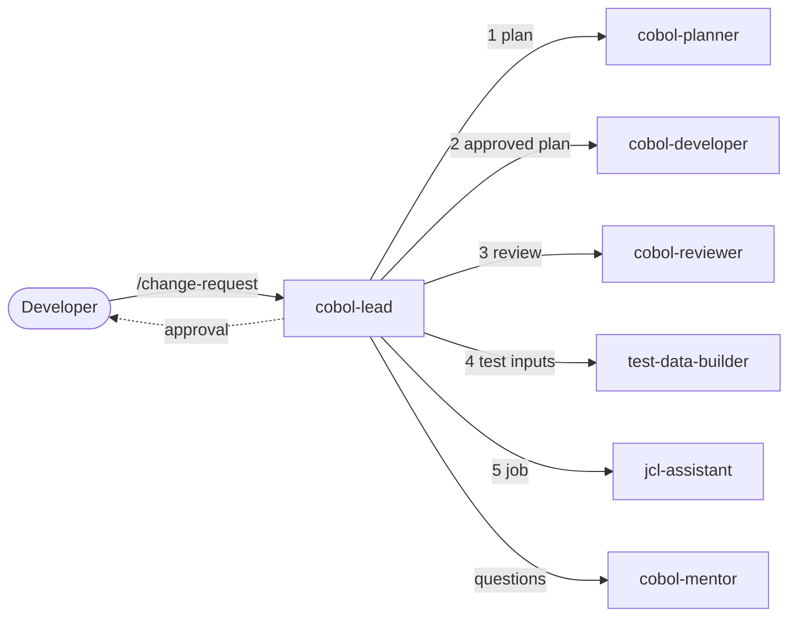

# GitHub Copilot for COBOL developers

> **Historical development profile.** This guide describes the `release` branch,
> not the active modernization agent team. Its agent names, writing commands and
> reset steps are not instructions for this branch. Use the
> [modernization guide](modernization/README.md) here.

This is a demo guide and talk track for COBOL developers moving from ISPF to
VS Code with the Rocket COBOL extension. It shows what GitHub Copilot can do
with IBM Enterprise COBOL, and why a structured setup (instructions, prompt
files, skills, and agents) gets much better results than ad hoc questions.

> Copilot does not replace COBOL knowledge; it multiplies it. Structure is how
> your team's knowledge (dialect, columns, conventions, error handling) reaches
> every answer.

1. [Set up the workspace](#1-set-up-the-workspace)
2. [VS Code for ISPF developers](#2-vs-code-for-ispf-developers)
3. [Why structure matters](#3-why-structure-matters)
4. [The COBOL agent team](#4-the-cobol-agent-team)
5. [Demo script](#5-demo-script)
6. [Rocket's own AI features](#6-rockets-own-ai-features)
7. [Guardrails](#7-guardrails)
8. [Troubleshooting](#8-troubleshooting)
9. [Reset after the demo](#9-reset-after-the-demo)

## 1. Set up the workspace

VS Code recommends these extensions when you open the repository (see
[extensions.json](../.vscode/extensions.json)):

- **GitHub Copilot Chat**
- **Rocket COBOL** for COBOL editing, and **Rocket Enterprise** for JCL,
  PL/I, BMS, IMS, and Assembler
- **Zowe Explorer** (optional) to browse data sets, submit jobs, and read the
  spool from VS Code

Open the repository root as the workspace folder. The
[workspace settings](../.vscode/settings.json) set:

| Setting | Value | Why |
| --- | --- | --- |
| `rocketCOBOL.editor.dialect` | Enterprise COBOL for z/OS | Colors the code for IBM's dialect instead of Rocket's default dialect |
| `rocketCOBOL.editor.sourceFormat` | fixed | Fixed format: columns 1-6, 7, 8-11, and 12-72 |
| `files.trimTrailingWhitespace` | false | Keeps fixed-width records and untouched source lines byte-for-byte |
| `files.insertFinalNewline` | false | Avoids incidental changes to legacy members |
| `[cobol]` `editor.insertSpaces` | true | Keeps tab characters out of COBOL source |

What Rocket gives you depends on whether a Rocket COBOL product (Visual COBOL
or Enterprise Developer) is installed alongside the extension:

| Capability | Extension only | With Visual COBOL or Enterprise Developer |
| --- | --- | --- |
| Dialect coloring, fixed-format tab stops, column rulers, comment toggling, snippets, JCL support | Yes | Yes |
| Rocket agent skills `init-cobol` and `set-product-env`, and the **Rocket Skill Templates** view | Yes | Yes |
| Local compile, run, and debug | No ("No COBOL product was found or configured") | Yes |
| Outline, Go to Definition, Find References, copybook resolution, syntax problems | Only when the Rocket language server runs | Yes |
| Rocket Analysis Assistant (Explain Selection, Explain File, Create Comment) | No | Product 11 or later, plus the Rocket Analyzer extension |
| Rocket context for Copilot: language server and documentation MCP servers, `understanding-cobol-code` skill | No | Product 12.0 or later |
| GitHub Copilot inline suggestions, chat, and this repository's agents | Yes | Yes |

The Rocket language server is running if **Update syntax reporting** appears
in the COBOL editor's context menu. Everything in this guide works with the
extension alone: GitHub Copilot provides the AI, and Rocket provides the COBOL
editing experience.

## 2. VS Code for ISPF developers

| ISPF or TSO habit | VS Code with Rocket |
| --- | --- |
| 3.4 DSLIST and member list | The Explorer; `Ctrl+P` opens a member by name. Zowe Explorer for real data sets. |
| EDIT with `HILITE` | Rocket coloring for the Enterprise COBOL dialect |
| `COLS` | Rulers mark the sequence area, column 7, Area A, and column 72 |
| `TABS` | `Tab` and `Shift+Tab` move between COBOL tab stops |
| Line commands `C`, `M`, `R` | `Shift+Alt+Down` copies a line, `Alt+Up/Down` moves it, `Ctrl+C`/`Ctrl+V` |
| Column shift `((` and `))` | `Ctrl+]` and `Ctrl+[` indent or outdent to the next tab stop; `Shift+Alt+drag` for a column selection |
| `*` in column 7 | `Ctrl+/` toggles a COBOL comment line; `Ctrl+K Ctrl+C` and `Ctrl+K Ctrl+U` add or remove one |
| `FIND` and `CHANGE ALL` | `Ctrl+F` and `Ctrl+H`, with regex, match case, and whole word |
| SRCHFOR and SuperCE | `Ctrl+Shift+F` searches every program, copybook, and JCL member |
| `X ALL` then `F ALL` | Folding (`Ctrl+Shift+[`), plus the Outline when the language server runs |
| SuperC compare | Source Control diff, Timeline, and **Compare Selected** |
| Endevor, ChangeMan, SCLM | Git locally for history, branches, and diffs. Keep your SCM for promotion. |
| SUBMIT and SDSF | Zowe Explorer, or ISPF as before. Copilot never submits jobs. |
| PF1 and the manuals | Copilot Chat, backed by this repository's skills |

### Ten tips for the first week

1. **Open the folder, not single members.** Copilot and Rocket need the
   copybooks and JCL in the same workspace to answer questions about your
   program.
2. **Check the dialect and format.** The wrong dialect changes coloring and
   what every tool considers valid COBOL.
3. **Let Copilot type in Area B.** Write a column-7 comment describing the next
   statements, or start a statement in column 12, then pause:
   - `Tab` accepts the ghost text.
   - `Ctrl+Right` accepts one word.
   - `Alt+]` shows the next alternative.
   - `Esc` dismisses it.

   If no suggestion is showing, `Tab` moves to the next COBOL tab stop instead.
4. **Use inline chat for small edits.** Select some lines and press `Ctrl+I`,
   for example: "check the file status after this OPEN, like 1015-Load-Type
   does".
5. **Pick the right chat mode** (`Ctrl+Alt+I`):
   - **Ask** for questions.
   - **Plan** for a plan without edits.
   - **Agent** for edits across several files.
   - One of this repository's custom agents.
6. **Give context on purpose.** Type `#` to attach a file, folder, or selection,
   or drag copybooks into the chat. The program plus its copybooks beats the
   program alone.
7. **Reuse team prompts.** Type `/` to list this repository's slash commands,
   for example `/explain-program TABLE1`.
8. **Ask for evidence.** Good answers cite `path:line`. If an answer has no
   line numbers, ask "show me where".
9. **Review every change.** Agent edits arrive as a diff with **Keep** and
   **Undo**. Git is your safety net: `git restore <file>`.
10. **Keep data synthetic.** Never put production data, credentials, or
    customer information in a prompt. Generate test data instead.

## 3. Why structure matters

The same question gets very different answers depending on the context
Copilot has. Each level adds context once, so nobody has to repeat it in every
prompt.

| Level | You add | In this repository | What it fixes |
| --- | --- | --- | --- |
| 0 | A plain question | (nothing) | Generic COBOL, often GnuCOBOL or Micro Focus style, code past column 72, invented behavior |
| 1 | Explicit context | `#file`, the selection, copybooks dragged into chat | Answers about this program |
| 2 | Repository instructions, always on | [copilot-instructions.md](../.github/copilot-instructions.md) | Target dialect, folder layout, `path:line` citations, "never claim it compiled" |
| 3 | File-pattern instructions | [cobol.instructions.md](../.github/instructions/cobol.instructions.md), [jcl.instructions.md](../.github/instructions/jcl.instructions.md) | Columns, house style, and file status and RC conventions whenever COBOL or JCL is created or changed |
| 4 | Prompt files (team slash commands) | [.github/prompts](../.github/prompts) | Repeatable tasks with a fixed output format |
| 5 | Skills, loaded on demand | [.github/skills](../.github/skills) | File status and abend reference, impact-analysis procedure, record-length rules |
| 6 | Custom agents with their own roles and tools | [.github/agents](../.github/agents) | A read-only mentor, planner, and reviewer, and a developer that may edit |
| 7 | A lead agent with subagents | [cobol-lead](../.github/agents/cobol-lead.agent.md) | Plan, human approval, implementation, independent review |

Five principles to leave with the audience:

1. **Context beats clever prompts.** Give Copilot the program, its copybooks,
   and its JCL.
2. **Pin the platform.** State the dialect and source format, or you get
   constructs your compiler rejects: level-78 constants, free format, local
   file paths in `ASSIGN`.
3. **Separate roles.** The agent that writes the code does not review it, and
   read-only agents cannot edit by accident.
4. **Plan, approve, then edit.** A person approves the plan before any source
   changes.
5. **Evidence over confidence.** Cite `path:line`, say "not compiled", and
   verify on z/OS.

## 4. The COBOL agent team



| Agent | Role | Tools | Writes to |
| --- | --- | --- | --- |
| [cobol-lead](../.github/agents/cobol-lead.agent.md) | Coordinates and stops for approval | agent, read, search, todo | Nothing |
| [cobol-mentor](../.github/agents/cobol-mentor.agent.md) | Explains programs, data, and job failures | read, search | Nothing |
| [cobol-planner](../.github/agents/cobol-planner.agent.md) | Plans changes and analyzes impact | read, search | Nothing |
| [cobol-developer](../.github/agents/cobol-developer.agent.md) | Implements the approved plan | read, search, edit | COBOL source and copybooks |
| [cobol-reviewer](../.github/agents/cobol-reviewer.agent.md) | Reviews independently | read, search | Nothing |
| [jcl-assistant](../.github/agents/jcl-assistant.agent.md) | Explains and writes JCL | read, search, edit | `Mainframe/ZOS/*/jcl/` |
| [test-data-builder](../.github/agents/test-data-builder.agent.md) | Builds fixed-width test data | read, search, edit, execute | `test-data/<PROGRAM>/` |

You can also pick any specialist directly from the agent dropdown. VS Code
enforces each agent's tool list, so the mentor, planner, and reviewer have no
edit tool at all. The "Writes to" column is an instruction, not a sandbox.

| Slash command | Agent | Use it to |
| --- | --- | --- |
| `/explain-program` | cobol-mentor | Get to know a program |
| `/explain-abend` | cobol-mentor | Trace an abend, file status, or RC back to the source |
| `/document-program` | Agent | Write `docs/programs/<NAME>.md` |
| `/impact-analysis` | cobol-planner | See what a copybook or field change affects |
| `/review-cobol` | cobol-reviewer | Review a program or your uncommitted changes |
| `/change-request` | cobol-lead | Run the full plan, approve, implement, and review flow |
| `/write-jcl` | jcl-assistant | Create compile, link, and run JCL |
| `/test-data` | test-data-builder | Build fixed-width test data with expected results |

| Skill | Loaded when |
| --- | --- |
| [zos-runtime-codes](../.github/skills/zos-runtime-codes/SKILL.md) | A file status, abend, RC, or job log is involved |
| [copybook-impact-analysis](../.github/skills/copybook-impact-analysis/SKILL.md) | A copybook, record, or shared field changes |
| [record-layouts](../.github/skills/record-layouts/SKILL.md) | Record lengths, offsets, or test data are needed |

Skills load automatically when a request matches their description. You can
also run one from the `/` menu, for example `/zos-runtime-codes S0C7`.

## 5. Demo script

The script takes about 30 minutes, and every step uses files in this
repository. Model output varies between runs, so use the expected results to
guide the discussion, not as a script Copilot must match.

### Before the session

- [ ] Open the repository root in the VS Code build that has Rocket installed,
      and sign in to GitHub Copilot.
- [ ] Commit or stash your own work, then switch to a throwaway branch:
      `git switch -c demo/copilot-cobol`.
- [ ] Open the agent dropdown in the Chat view and check that all seven agents
      appear (the five `cobol-*` agents, `jcl-assistant`, and
      `test-data-builder`). Type `/` and check that the eight prompt files and
      the three skills appear. Rocket and VS Code add commands of their own.
- [ ] In **Configure Tools**, make sure **Run Subagent** is enabled.
- [ ] Open [TABLE1.cbl](../Mainframe/ZOS/ECBAP/cbl/TABLE1.cbl) and
      [hinstype.dat.txt](../common/data/ECBAP/hinstype.dat.txt).
- [ ] For Demo 2, open a second VS Code window with no folder
      (`Ctrl+Shift+N`).

### Demo 1: the editor (3 minutes)

In TABLE1.cbl:

- Point out the rulers, then press `Tab` on an empty line to jump between the
  tab stops.
- Show the `D` lines in `1099-Verify-Type-Table` (TABLE1.cbl:284-289). These
  debugging lines are compiled only `WITH DEBUGGING MODE`.
- Toggle a comment line with `Ctrl+/`.
- Show an inline suggestion. `3000-End-Job` (TABLE1.cbl:636-638) only says
  "Normally, I would have something to do here". After its last line, add the
  comment line `      * Display how many insurance types were loaded`.
  Press Enter, go to column 12, and wait. Accept the ghost text with `Tab`. A
  typical suggestion displays `WS-TL-Records-Read`.
- Undo the edit with `Ctrl+Z` (or run
  `git restore Mainframe/ZOS/ECBAP/cbl/TABLE1.cbl` if it was saved), so that
  the later demos start from the original source.

### Demo 2: the same question, with and without structure (5 minutes)

1. Switch to the window with no folder open. It has none of this repository's
   instructions, prompt files, skills, or agents. Paste paragraphs
   `1010-Load-Type-Table` through `1099-Verify-Type-Table`
   (TABLE1.cbl:253-297) into the chat and ask: *"Is this COBOL table-loading
   code safe?"* Copilot may spot some problems, but it cannot see the table
   definition, the WSFST copybook, or your conventions. Expect hedged advice
   with no line numbers, possibly including syntax that Enterprise COBOL does
   not accept.
2. Back in the repository window, run `/review-cobol TABLE1`. The
   cobol-reviewer reads the whole program and the WSFST copybook, then returns
   ranked findings with `path:line`.

Presenter cheat sheet: these defects really exist in TABLE1.

| # | Severity | Where | Finding |
| --- | --- | --- | --- |
| 1 | Blocker | TABLE1.cbl:266 | `1015-Load-Type` stores `TL-REC` in `WS-Type(WS-Type-IDX)` without checking the index against the 10-entry table (TABLE1.cbl:232). The size check runs only after the whole file is loaded (TABLE1.cbl:258-259, 290). An 11th record is therefore written past the end of the table, a storage overlay that may cause an S0C4, before RC 9 can be set. |
| 2 | Major | TABLE1.cbl:258 | `WS-TL-Records-Read PIC S9(4) COMP` (TABLE1.cbl:43) is moved to `WS-Type-Occurs-Dep-Counter PIC S99 COMP-3` (TABLE1.cbl:231). From 100 records upward the high-order digits are lost (105 becomes 05), so the RC 9 check passes when it should fail. |
| 3 | Major | TABLE1.cbl:254 | `OPEN INPUT TABLOAD` is not checked. A missing DD (status 35) shows up later as a failed READ with status 47 and RC 8, which is misleading. |
| 4 | Major | TABLE1.cbl:43 | The record counter `WS-TL-Records-Read` has no VALUE clause and is never set to zero before `ADD +1` (TABLE1.cbl:268-269). Whether the count starts at zero depends on how the runtime initializes storage, not on the code, and the count feeds the RC 9 check. |
| 5 | Minor | TABLE1.cbl:273 | `NEXT SENTENCE` is used inside `IF ... END-IF`; use `CONTINUE` instead. |
| 6 | Minor | TABLE1.cbl:231, 257 | The OCCURS DEPENDING ON object has no VALUE and is set only after the load, and `CLOSE TABLOAD` is not checked. |

The program header promises "RETURN-CODE = 0009" when the table is too small.
Findings 1 and 2 show why a comment is not a test.

### Demo 3: get to know a program (4 minutes)

Run `/explain-program TABLE1` and point out:

- The Mermaid PERFORM diagram, and the `path:line` behind every statement.
- TABLOAD has 3-byte records. Its sample data,
  [hinstype.dat.txt](../common/data/ECBAP/hinstype.dat.txt), matches the
  88-levels `HMO`, `PRI`, `PPO`, `AFF`, and `MED` (TABLE1.cbl:236-240).
- The two error exits: RC 8 for a failed READ and RC 9 for a table that is too
  small.
- The table techniques the program demonstrates: one- to three-dimensional
  tables, subscripts versus indexes, and OCCURS DEPENDING ON.

### Demo 4: from job output back to the source (3 minutes)

Run:

```text
/explain-abend TABLE1 ended with RC 8. SYSOUT shows "** ERROR **: 1015-TABLOAD", "Read TABLOAD Failed." and "File Status: 47".
```

Those messages are the program's own DISPLAYs (TABLE1.cbl:275-277), so this is
a realistic "what if". Expected answer:

- Status 47 means a READ on a file that is not open.
- The READ overwrote the status of the unchecked OPEN at TABLE1.cbl:254, so
  SYSOUT alone cannot say why the OPEN failed.
- The most likely cause is a missing or misspelled `//TABLOAD DD`, which gives
  OPEN status 35. An attribute conflict (status 39) is another possibility.
- The step's allocation messages in the job log confirm the cause.

This ties back to finding 3 in Demo 2, and it shows the agent separating
evidence from inference.

### Demo 5: what breaks if I change a copybook? (4 minutes)

Run:

```text
/impact-analysis PATIENT: widen FD-:tag:-Patient-Phone from X(10) to X(12)
```

Expected answer:

- [WS162E](../Mainframe/ZOS/ECBAP/cbl/WS162E.cbl), whose PROGRAM-ID is
  HOSPEDIT, copies PATIENT twice: for the INFILE and ERRFILE records
  (WS162E.cbl:69, 81).
- The record grows from 89 to 91 bytes, so every later field shifts. The
  89-byte records in [hospin.dat.txt](../common/data/ECBAP/hospin.dat.txt) and
  the error file data must be rebuilt, and the LRECL must change on z/OS.
- WS162E moves the phone number into the 10-byte `WS-OutFile-Patient-Phone`
  (WS162E.cbl:140, 427) and formats only positions 1-10 for the report
  (WS162E.cbl:428-433). A 12-character number would be truncated in both
  outputs, so a good answer asks whether all 12 characters must be kept.
- The repository has no JCL for WS162E, so the DD and DCB changes are listed
  as unknowns to check on the mainframe.

For a wider blast radius, follow up with
`/impact-analysis WSFST: add an 88-level for file status 35`. Sixteen programs
copy WSFST with `REPLACING`. The member exists four times:

- The copies in `common/cpy` and `Internal-Sort/cpy` are identical.
- The `ECBAP/cpy` copy only adds comment lines.
- The Zowe `wsfst.cpy` differs only in the letter case of one name, which
  COBOL ignores.

The SYSLIB order decides which copy a program gets.

### Demo 6: a change request with the agent team (10 minutes)

Run the following, or pick **cobol-lead** in the agent dropdown and paste the
text without the slash command:

```text
/change-request TABLE1: make the insurance-type table load safe.
Goal: stop before storing a record that does not fit in WS-Type-Table (10 entries) and end with RC 9 and the existing messages; check the OPEN of TABLOAD and end with RC 8 showing the file status.
Source scope: change only Mainframe/ZOS/ECBAP/cbl/TABLE1.cbl; no copybook changes.
New files allowed: test data in test-data/TABLE1/ and JCL in Mainframe/ZOS/ECBAP/jcl/TABLE1.jcl.
Constraints: keep the paragraph numbering, DISPLAY style, and return codes; IBM Enterprise COBOL, fixed format.
Acceptance: 5 types gives RC 0; 10 types gives RC 0; 11 types gives RC 9 with nothing stored past entry 10; a missing TABLOAD DD gives RC 8 with status 35.
After the review, create test data for these scenarios, then JCL that compiles TABLE1 once and runs every scenario.
```

Narrate as it runs:

1. The lead turns the request into a todo list and hands planning to
   cobol-planner, a subagent with its own context and no edit tool.
2. The lead stops for approval. Read the plan with the audience, and check
   whether it sets `WS-TL-Records-Read` to zero before the load (finding 4 in
   Demo 2). If it does not, reply
   `Approved, and also set WS-TL-Records-Read to zero before the load`. This
   shows a person correcting the plan before any code changes. Otherwise,
   reply `Approved`.
3. cobol-developer edits only TABLE1.cbl. Open the diff and show that the
   columns are intact, the existing style is kept, and a maintenance log entry
   was added.
4. cobol-reviewer reviews independently and gives a verdict. If it requests
   changes, the lead sends them back to the developer once.
5. test-data-builder writes `test-data/TABLE1/`, for example files with 5,
   10, and 11 records of 3 bytes each, plus a README of expected results.
   The lead then passes those file paths to jcl-assistant, which writes
   `Mainframe/ZOS/ECBAP/jcl/TABLE1.jcl`. That job has one compile step and one
   run step per scenario, including a run step without the TABLOAD DD.
6. The final report lists the changes with `path:line` and the z/OS
   verification steps, and states that nothing was compiled.

Close with: "Same Copilot, same model. The difference is structure:
instructions, skills, roles, and an approval step."

## 6. Rocket's own AI features

Rocket COBOL 2.x also plugs into Copilot. This optional segment shows how
vendor building blocks fit into the same structure:

- **Rocket Skill Templates** is a view in the Explorer side bar. It holds
  ready-made skills you can add to the workspace or your user profile, such as
  COBOL code review, format conversion, constant extraction, and typedef
  refactoring.
- **Built-in skills:**
  - `init-cobol` creates starter instruction files (AGENTS.md and
    `.instructions.md`) for a new COBOL project. Compare its output with the
    curated instructions in this repository.
  - `set-product-env` helps an agent find the Rocket compiler tools when they
    are not on PATH.
- **With Visual COBOL or Enterprise Developer 12.0 or later**, two MCP
  servers give Copilot compiler-grade context:
  - the Rocket COBOL language server (symbols and parse information);
  - the COBOL documentation server (`cobol_docs_search`).

  The `understanding-cobol-code` skill also makes Copilot check that
  documentation before it writes COBOL.
- **`#getCobolProductInfo`** is a Copilot tool that reports the installed Rocket
  product and its version. With only the extension installed, it answers "No
  installed product found", which shows the audience which column of the
  table in section 1 applies to them.

Teaching moment: several templates target Rocket and Micro Focus language
extensions that IBM Enterprise COBOL on z/OS does not support. Examples are
level-78 constants, TYPEDEF, parameterized sections, and conversion to free
format. That is exactly why this repository's instructions pin the dialect.
Read a skill before you add it, and keep your platform rules in the always-on
repository instructions so that every agent sees them.

## 7. Guardrails

- **Copilot does not compile or run anything here.** The proof is still the
  compile listing (RC 0), the run on z/OS, and the job output. The agents say
  so in every result.
- **Expected results derived from the source are not mainframe results.** Test
  data READMEs label them that way.
- **Data stays synthetic.** Never put production data, credentials, or
  customer information in prompts or files. Your organization's Copilot
  policies, such as content exclusion and model availability, apply.
- **People decide.** The lead stops for approval, every edit is a reviewable
  diff, and your usual review and promotion process (Endevor, ChangeMan,
  pull request review) still applies.
- **Tools are enforced; rules are guidance.** VS Code enforces each agent's
  tool list, but folder ownership and "never submit jobs" are instructions.
  Keep tool and terminal approvals turned on.

## 8. Troubleshooting

| Symptom | What to check |
| --- | --- |
| The custom agents are missing from the dropdown | Open the repository root as the workspace. In the Chat view, select **Configure Chat** (gear icon) and then **Agents** to see load errors. Check the YAML front matter. |
| cobol-lead says it cannot delegate | In **Configure Tools**, enable **Run Subagent**. Agent names are case-sensitive and must match the `agents` list in cobol-lead. |
| The slash commands are missing | Prompt files must be in `.github/prompts` and end in `.prompt.md`. |
| Instructions seem to be ignored | Expand **References** in the response to see which instruction files were used, and check the `applyTo` patterns. |
| A Copilot suggestion disappears when you press Tab | With no suggestion showing, Rocket's `Tab` moves to the next COBOL tab stop. Press `Tab` while the ghost text is visible, or use `Ctrl+Right`. |
| COBOL coloring looks wrong | Check `rocketCOBOL.editor.dialect` in the workspace settings, or run **Set COBOL dialect for active document**. |
| Trailing spaces disappear from test data | The workspace sets `files.trimTrailingWhitespace` to false. Check for a user setting that overrides it for a specific language. |
| The Rocket Analysis Assistant shows "Missing Extension" | It needs the Rocket Analyzer extension and product version 11 or later. |

## 9. Reset after the demo

These commands remove only what the demo creates:

```powershell
git restore Mainframe/ZOS/ECBAP/cbl/TABLE1.cbl
Remove-Item -Recurse -Force test-data, Mainframe/ZOS/ECBAP/jcl, docs/programs -ErrorAction SilentlyContinue
git switch -
git branch -D demo/copilot-cobol
```
