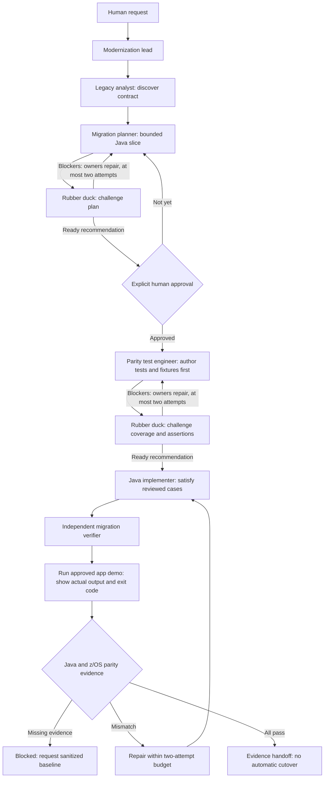

# COBOL-to-Java modernization harness

This branch changes how agents work, not the existing COBOL programs.
The legacy sources, copybooks, JCL, scripts, templates and samples are the
read-only baseline. Migration is incremental and requires a separately approved
contract for each program/slice. No Java application has been generated, no
framework is selected, and no equivalence or production-readiness claim is made.

## What was adapted from the Delivery Center

Reference: `comeredon/copilot-agentic-delivery-center`, revision
`978a7827d8e234e0fd44b2ffeaf7d6db62380afa`, inspected via its default branch
`chore/refresh-copilot-harness`.

That repository separates its .NET application (`src/` and `tests/`) from an
external delivery harness: `AGENTS.md`, `.github/agents`, scoped instructions,
prompts, procedural skills, hooks under `.github/hooks` and `eng/agent-hooks`,
workflows, and evidence/gate schemas. Its orchestrator routes narrow specialists,
limits repair loops and requires an independent quality verifier. Its local
gate/ledger proof is explicitly distinct from durable publication.

Here, discovery and differential parity replace .NET delivery assumptions:

| Reference concept | Modernization adaptation |
| --- | --- |
| Delivery orchestrator | `modernization-lead`, without editing or execution tools. |
| Requirements planner | Read-only legacy discovery plus a migration planner and explicit human approval. |
| .NET implementer | Java implementer limited to an approved slice. |
| Test engineer | Synthetic characterization and differential parity cases. |
| Quality verifier | Independent migration verifier with separate Java and z/OS parity verdicts. |
| Hooks and quality gate | Supported Copilot pre-tool hook, conservative command/path policy and tested evidence consistency. |
| Gate ledger/evidence | Local slice evidence only; no fabricated ledger or publication service. |

We do not copy .NET/Aspire/Blazor dependencies, model pins, GitHub Project
automation, automatic publishing or a claim that repository hooks are complete
security enforcement. The reference hook shape was not copied verbatim; this
branch uses the documented `type`, `bash`, `powershell`, `timeoutSec`,
`toolName`/`toolArgs` and `permissionDecision` contract.

## Agent flow



The analyst, planner and lead do not write files. The implementer owns production
code and the approved build descriptor. The test engineer owns tests, synthetic
fixtures and case documentation. The verifier authored neither and cannot edit.
Use fewer roles for simple read-only questions; never manufacture independence.

### Test-first authoring and rubber ducking

`migration-rubber-duck` is a read-only challenger, not another implementer or
the final verifier. Before human approval, it checks the plan against source
evidence for unsupported assumptions, semantic gaps and unclear interfaces or
acceptance criteria. After approval, the test engineer authors tests, synthetic
fixtures and a rule-to-case matrix against the planned interfaces before
production implementation. The rubber duck then challenges coverage, exact-byte
assertions, failure paths and baseline provenance.

The lead routes material findings to their owners and stops implementation until
blockers are resolved. Findings identify source locations, the concrete failure
scenario, affected rules/cases and the required clarification or correction.
Each checkpoint returns findings, unresolved questions and a `ready` or `blocked`
recommendation. Stop after two unsuccessful repair rounds at a checkpoint.
Changed contracts, interfaces or acceptance criteria require human reapproval;
never weaken tests to fit Java output.

The implementer receives the reviewed cases and approved contract. The verifier
receives both rubber-duck reviews and their resolutions alongside the actual
build/test and differential evidence. Rubber-duck readiness is neither human
approval nor a verification/parity pass. Tests authored before production may
not yet compile or run; do not call that an observed failing behavior test or
claim an executed red/green cycle.

### Synthetic data and dependency mocks

During planning, inventory each scenario's required input records, encoding,
expected outputs, fixture/generator paths, external dependencies and owner.
Mark data as needed, available or not applicable with a reason. After approval,
the test engineer creates missing deterministic synthetic fixtures or generators
before production implementation, keeping case IDs and input hashes traceable.
Cover normal, empty, boundary, malformed and failure/restart cases where relevant.
Use no real customer data and leave legacy sample files unchanged.

Mocks or fakes are appropriate only at approved external boundaries, such as a
clock or unavailable service, with specified responses and failures. Unknown
dependency behavior needs clarification, not a fabricated stub contract. Test
actual codecs, decimal calculations and file adapters using synthetic records;
mocking these would hide the behavior being verified. The rubber duck checks
fixture coverage and mock boundaries before implementation.

Synthetic expected results inferred from source support Java characterization,
not observed COBOL parity. Differential verification still needs trusted,
sanitized z/OS results for the same synthetic inputs and environment provenance.

### Show the running application's results

Each slice plan includes an approved application entry point and run command,
working directory, deterministic synthetic demonstration input, expected result
and isolated output paths. After Java build/tests succeed, the independent
verifier runs that entry point and returns actual stdout/stderr, process exit
code and generated-file paths. A Maven/JUnit summary alone is not an application
demonstration. This requires a runnable slice; installed tools alone produce no
application result.

The handoff shows the command, input/case ID and a bounded actual output preview.
For file-only applications, preview the generated file; for binary or EBCDIC
records, show a labeled decoded or hex view while preserving the original bytes.
Label truncated previews and link the full captured transcript/output references,
which the test engineer persists in assigned case documentation. Never replace
expected fixtures or z/OS baselines with demonstration output.

Record the demonstration command in evidence under the existing `java` gate.
A failed required run makes that gate `fail`; an unrun/blocked command makes it
`blocked`. Demonstration success remains distinct from trusted z/OS parity.
Commands still require slice approval and applicable host permission. If hook
policy blocks a run, report it and request human-owned policy maintenance; do not
alter hooks, disguise the command or bypass controls.

## Starting a slice

The workspace recommends the VS Code Java extension pack alongside Rocket for
reading the legacy baseline. Recommendations do not install extensions or select
a JDK. Approve the Java toolchain and dependencies with the first slice.

### Java prerequisites

A Java framework such as Spring Boot or Quarkus is optional, not a machine-level
prerequisite. A small batch slice can use plain Java. Compiling and running it
requires an approved JDK (including `java` and `javac`); a JRE alone is not enough.
Maven or Gradle manages builds and project dependencies, including a test library
such as JUnit. Frameworks and test libraries, if approved, are project dependencies
rather than separate global framework installations.

Check tool availability during planning. Do not install a JDK, build tool,
framework or test dependencies until the slice's stack and commands are approved.
Available tools do not select the target Java version or establish a passing build.

Select `modernization-lead` or use `/modernize-program`:

> Analyze `Mainframe/ZOS/ECBAP/cbl/WS162E.cbl` for a bounded Java batch migration.
> Discover the current contract and propose a slice. Keep legacy files unchanged
> and stop for approval before implementation.

This is an example request, not approval to migrate that program. Before coding,
the human approves scope/non-goals, target JDK, Maven or Gradle, framework or none,
dependencies, file encoding/framing, decimal/error semantics, intended differences,
scenario matrix and exact commands. Unknown rules and missing called modules must
be resolved or explicitly excluded; do not silently substitute behavior.

Use these output locations after approval:

| Path | Content |
| --- | --- |
| `modernization/<slice>/` | Isolated Java slice, normally `src/main/java`, `src/test/java`, and its build descriptor. |
| `test-data/modernization/<slice>/` | Deterministic synthetic inputs and sanitized reference files. |
| `docs/modernization/<slice>/` | Approved contract, field/rule mappings, case matrix, provenance and evidence. |

Do not modify `common/data` to make Java tests pass. Do not repair pre-existing
COBOL defects during translation; document them and obtain approval for any
intentional difference. Existing signed zoned/packed/binary data, EBCDIC,
padding, sort order, overflow/truncation, EOF/status and restart rules require
explicit mappings, not generic "equivalent Java" claims.

## Skills and commands

The retained `copybook-impact-analysis`, `record-layouts` and `zos-runtime-codes`
skills support reading the baseline. New procedures are
`discover-legacy-contract`, `plan-java-slice`, `map-cobol-java-semantics`,
`build-parity-cases` and `verify-migration-parity`.

`/explain-program`, `/explain-abend`, `/impact-analysis`, `/review-cobol`,
`/document-program` and `/test-data` are retargeted to migration analysis or
approved parity work. `/change-request` is an alias for migration delivery.
The legacy `/write-jcl` command is removed; `/explain-job-contract` is read-only.
The older COBOL demo documents are historical, not the active branch workflow.

## Hooks: enforced subset and limits

`.github/hooks/guardrails.json` invokes `tools/agent_hooks/guardrails.py`.
Python 3 must be available as `python3` on macOS/Linux or `python` on Windows.
The command hook:

- Denies malformed/unsupported payloads and unknown tools with a static reason,
  without printing arguments, credentials or command output.
- Checks explicit read paths for credential-shaped and Git-internal files.
- Resolves absolute/relative paths, traversal and symlinks before checking writes.
  Recognized edits, multi-target edits and patch/move targets must stay in the
  three migration output roots on a `modernization/` branch.
- Denies shell commands except a small allowlist. There is no compound-shell,
  arbitrary interpreter, network, mainframe, Git push, merge, or guardrail-edit
  escape hatch. Other tools need human-owned hook integration.

Allowed commands include:

```text
git status --short
git branch --show-current
git diff --stat
git diff --check
git diff -- modernization/ test-data/modernization/ docs/modernization/
java -version
javac -version
mvn --version
python3 -m unittest discover -s tests/guardrails -v
python3 tools/modernization/check_evidence.py docs/modernization/<slice>/evidence.json
mvn -B -f modernization/<slice>/pom.xml verify --no-transfer-progress
```

Run Python harness/validator commands from the repository root. The Maven entry
is a supported shape, not evidence that Maven is installed, that a project exists,
or that a build has been approved. A Gradle project, an additional comparison
runner or any different command requires explicit human-owned policy maintenance
and tests before execution. Do not wrap denied commands to bypass the hook.

**Limits:** these are repository hooks, not an operating-system sandbox.
Host admission/loading, tool naming/argument formats and timeout behavior matter.
The documented command-hook timeout is fail-open; hooks may also be disabled by
the host. Directory-wide searches can encounter files beyond individually
checked read paths. Executable builds, plugins and tests can access or mutate
files and the network; the allowlist does not sandbox them. Aliased/new tools,
agent role ownership, approval authenticity, content-level privacy, read races,
and provenance authenticity are not fully mechanically enforced here.

Use trusted toolchains, sandbox/network restrictions and least-privilege
credentials. Human review of build files, protected controls and evidence remains
mandatory. This setup does not configure remote branch protection, CODEOWNERS
approval requirements, persistent audit storage or durable gate ledgers.
Repository-only controls must not be presented as enterprise-wide enforcement.

### Host smoke check

In a new trusted session that has loaded this branch's configuration, confirm
the seven migration agents appear and the removed writing agents do not. Reload
the host/session if it cached the development profile.
Ask to read a public repository document, then request a dry denied edit to a
legacy file and a dry denied shell command such as `git push`. Confirm the hook
denies before execution and the worktree is unchanged; do not grant overrides.
Only after that, try an allowed edit in a disposable migration slice.
Do not test with real secrets or real mainframe connections.

No host-level smoke check is implied by the local unit tests. Supported
hook formats are documented in the
[Copilot hooks reference](https://docs.github.com/en/copilot/reference/hooks-reference).

## Evidence and gate truthfulness

The local harness check is:

```sh
python3 -m unittest discover -s tests/guardrails -v
```

`.github/workflows/modernization-harness.yml` runs this check on pull requests,
modernization-branch pushes and manual dispatch. It does **not** build Java,
run COBOL, compare z/OS output or make a migration release-ready.

A slice record uses `schemas/migration-evidence.schema.json` and reports
`harness`, `java`, `semantics` and `parity` independently as `pass`, `fail` or
`blocked`. Commands include actual exit codes (null if unrun) and artifact
references. Each differential case cites source rules and a sanitized observed
z/OS baseline with source revision, input/output SHA-256, compiler options,
runtime, charset, framing and a job/result reference.

```sh
python3 tools/modernization/check_evidence.py docs/modernization/<slice>/evidence.json
```

The standard-library validator checks fields, distinct proposer/verifier names,
gate consistency, executed-command requirements, nonempty passing case sets and
baseline provenance fields. It **does not authenticate** approval, identities,
hashes, artifact contents, case coverage or execution. Its successful exit means
the record is structurally consistent, even when the declared status is blocked
or failed; it is not a migration gate pass. The independent verifier and human
must inspect the actual evidence.

Without trusted sanitized z/OS outputs and environment provenance, parity stays
blocked even if all Java tests pass. There is no local COBOL compiler here.
Nothing in this harness authorizes a job submission, deployment, legacy removal,
replacement schedule, operational cutover, commit, push or publication.
